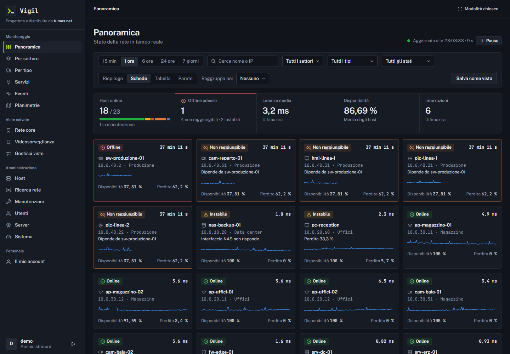
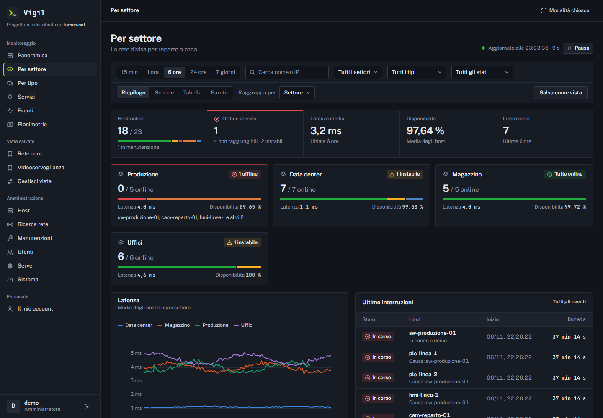
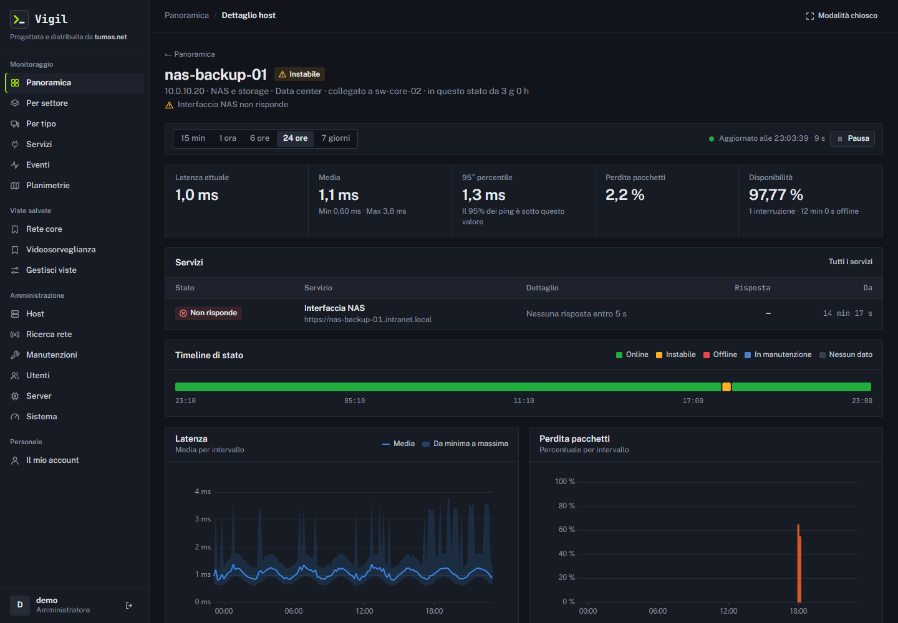
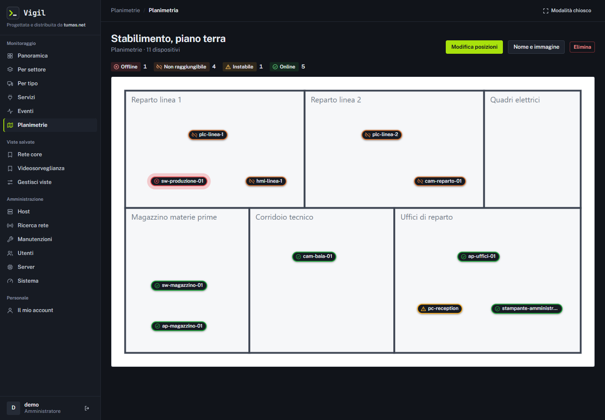

# Vigil

Monitoraggio dei dispositivi di rete, pensato per girare dentro l'intranet.

Vigil controlla server, switch, access point, stampanti, telecamere e macchine con un ping ogni 10 secondi, ne mostra lo stato in tempo reale e tiene lo storico di latenza, perdita di pacchetti e interruzioni. Gira su un solo server, senza servizi esterni e senza dominio pubblico.

Progettata e distribuita da [tumas.net](https://tumas.net).



_Tutte le immagini mostrano dati dimostrativi._

## Funzioni

**Monitoraggio**

- Stato di ogni dispositivo: online, instabile, offline, non raggiungibile, in manutenzione.
- Latenza, perdita di pacchetti e disponibilità, da 15 minuti a 7 giorni.
- Soglie di latenza e perdita per tipo di dispositivo.
- Controlli su porte TCP, siti web e scadenza dei certificati.
- Dipendenze: se cade uno switch arriva un solo avviso, e i dispositivi collegati risultano non raggiungibili.

**Lavoro quotidiano**

- Viste per settore e per tipo, con riepilogo, schede, tabella e parete.
- Viste salvate, personali o condivise.
- Planimetrie con i dispositivi sulla pianta e lo stato aggiornato.
- Manutenzioni programmate, che non generano avvisi e non pesano sulla disponibilità.
- Presa in carico dei guasti, con note che restano nello storico.
- Modalità chiosco per gli schermi a parete.
- Notifiche sui PC Windows, tramite un piccolo agente in PowerShell.

**Amministrazione**

- Ricerca dei dispositivi su una sottorete, con stima del tipo e del produttore.
- Import di un elenco di host.
- Account amministratore o visualizzatore, limitabili a settori e dispositivi scelti.
- Pagine sullo stato del server, del worker e del database.

| Riepilogo per settore | Dettaglio di un host |
|---|---|
|  |  |



## Come è fatta

| Parte | Tecnologia | Compito |
|---|---|---|
| Sito | Next.js e React | Interfaccia e API, sulla porta locale 3110 dietro nginx |
| Worker | Node.js | Ping, controlli sui servizi, ricerca sulla rete, pulizia dei dati |
| Database | PostgreSQL | Configurazione, storico e planimetrie |

La compilazione non scarica nulla da internet e il sito non carica risorse esterne: font e icone sono nel progetto. Internet serve solo per installare i pacchetti npm.

## Installazione

Serve un server Ubuntu o Debian **dentro la rete da controllare**, con PostgreSQL 14 o successivo, nginx, Node.js 24 e PM2. Il sito richiede HTTPS anche in intranet, ma basta un nome interno o un indirizzo IP.

```bash
git clone https://github.com/TumasDevelopment/Vigil.git ~/vigil
cd ~/vigil

# Con il certificato della tua azienda
sudo DOMAIN=vigil.azienda.local CERT=/etc/ssl/vigil/fullchain.pem KEY=/etc/ssl/vigil/chiave.pem bash deploy/setup.sh

# Oppure con un certificato autofirmato, generato dallo script
sudo DOMAIN=vigil.azienda.local SELF_SIGNED=1 bash deploy/setup.sh
```

Lo script crea il database con una password casuale, chiede nome e password del primo amministratore, configura nginx e avvia i processi. Si può rilanciare senza rischi.

La guida completa è in [INSTALLAZIONE.md](INSTALLAZIONE.md): preparazione del server, certificati, installazione manuale, impostazioni, backup, aggiornamenti e problemi frequenti.

## Sviluppo

Servono Node.js 22.18 o successivo e un database PostgreSQL locale.

```bash
npm ci
cp .env.example .env      # poi scrivi la connessione in DATABASE_URL
npm run migrate
npm run utente -- --username mario --role admin
npm run dev               # http://localhost:4110
```

| Comando | Cosa fa |
|---|---|
| `npm test` | Test automatici |
| `npm run typecheck` | Controllo dei tipi |
| `npm run build` | Compilazione di produzione |

## Sicurezza

Password e sessioni sono salvate come hash, i cookie sono `httpOnly` e `secure`, i tentativi di accesso sono limitati, la Content-Security-Policy usa un nonce, le query sono parametrizzate e i permessi si controllano su ogni pagina e azione.

Le credenziali stanno solo nel file `.env`, che è escluso da git. Per segnalare una vulnerabilità scrivi a [info@tumas.net](mailto:info@tumas.net), senza aprire una segnalazione pubblica.

## Licenza

Copyright © 2026 tumas.net.

Vigil è software libero, distribuito con licenza [GNU Affero General Public License 3.0](LICENSE) (`AGPL-3.0-only`). Puoi usarlo, modificarlo e ridistribuirlo alle condizioni della licenza, senza alcuna garanzia.

Se modifichi Vigil e lo fai usare ad altri attraverso la rete, la sezione 13 della licenza ti chiede di offrire a quegli utenti il codice sorgente della tua versione. Il link «Codice sorgente» nell'interfaccia punta a questo repository: se hai modificato Vigil, o se i tuoi utenti non raggiungono internet, imposta `SOURCE_URL` in `.env` sulla tua copia.

I font Public Sans e JetBrains Mono, in `app/fonts/`, sono distribuiti con licenza SIL Open Font License 1.1.
